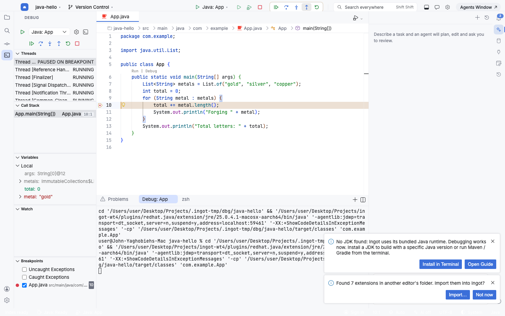

# Debugging

Ingot has a built-in debugger for **Java**, **PHP** (Xdebug), **JavaScript / TypeScript** (Node.js) and **Python**.



## Start debugging

1. Open the project and a source file.
2. Click in the gutter left of a line number to add a **breakpoint** (or press ⌘F8 / Ctrl+F8).
3. Pick a configuration in the title bar's run/debug selector (▾ next to Run) and click **Debug** (the bug icon), or press ⌃D / Shift+F9.

When the program stops at a breakpoint, the line is highlighted in gold and the **Debug** tool window (⌘5 / Alt+5) shows:

| Panel | What it shows |
| --- | --- |
| Threads / Call Stack | Every thread and its frames; click a frame to jump to its source. |
| Variables | Locals, `this` and globals of the selected frame. Right-click to copy or set a value. |
| Watch | Expressions you add; re-evaluated at every stop. |
| Breakpoints | All breakpoints, exception breakpoints (caught / uncaught) and enable / disable toggles. |
| Debug Console | Evaluate expressions in the paused frame; program output and logpoint messages. |

With **inline values** on (default), variable values are also shown at the end of each line while paused.

### Step controls

While a session runs, the title bar shows the debugger controls next to Run / Debug / Stop. The same actions are in the Debug tool window toolbar.

| Action | macOS | Windows / Linux |
| --- | --- | --- |
| Resume Program | ⌘⌥R | F9 |
| Pause Program | title bar | title bar |
| Step Over | F8 | F8 |
| Step Into | F7 | F7 |
| Step Out | ⇧F8 | Shift+F8 |
| Restart | title bar | title bar |
| Stop | ⌘F2 | Ctrl+F2 |

**Run** (the play icon) starts the selected configuration without the debugger. In an npm project without a selected configuration, Run starts the `dev` / `start` script in a terminal as before.

## Breakpoints

- **Line breakpoint**: click the gutter, or ⌘F8 / Ctrl+F8 on the current line.
- **Conditional breakpoint**: right-click the gutter › *Add Conditional Breakpoint…* and enter an expression (`total > 10`), a hit count (`3`), or both.
- **Logpoint**: right-click the gutter › *Add Logpoint…* and enter a message; `{expression}` is replaced with its value, e.g. `metal = {metal}`. Logpoints print to the Debug Console without stopping.
- Edit, disable or remove a breakpoint from its right-click menu or the **Breakpoints** panel.

## Run/Debug configurations

Ingot looks at the project and suggests configurations, shown under **Detected in this project** in the selector:

| Project | Detected configurations |
| --- | --- |
| Maven (`pom.xml`) / Gradle (`build.gradle[.kts]`) | *Java: Main class* (Ingot finds the `main` method; asks when there are several) and *Java: Attach to tests* (port 5005: run `mvn test -Dmaven.surefire.debug` or `gradle test --debug-jvm`, then debug) |
| Single Java files | *Java: Current file* |
| PHP (`composer.json`, `index.php`, `*.php`) | *PHP: Listen for Xdebug* (port 9003), *PHP: Current script*, *PHP: Built-in web server* (`php -S localhost:8000`, `-t public` when there is a `public/` folder) |
| npm (`package.json`) | One per script (`dev`, `start`, `serve`, `test` first), plus *Node.js: Current file* |
| Python (`*.py`) | *Python: Current file* |

To save and edit configurations, open **Run › Edit Run/Debug Configurations…** (or pick it at the bottom of the selector, ⌃⌥R / Alt+Shift+F10). The editor lists the saved configurations; **+ Add** creates one from a detected configuration or a template (Java main class / current file / attach, PHP listen / script / server, Node.js file / attach, Python file). Common settings have their own fields, and every other setting is in the JSON box. **Debug** and **Run** save and start it.

Configurations are saved in the project's `.ingot/launch.json` (the standard `launch.json` format, so any debug adapter option works). `launch.json` files in other editors' project config folders are read too.

```jsonc
{
    "version": "0.2.0",
    "configurations": [
        { "type": "java", "request": "launch", "name": "App", "mainClass": "com.example.App", "args": "--verbose" },
        { "type": "php", "request": "launch", "name": "PHP: Listen for Xdebug", "port": 9003 },
        { "type": "node", "request": "launch", "name": "npm run dev", "runtimeExecutable": "npm", "runtimeArgs": ["run", "dev"] }
    ]
}
```

## Language setup

Ingot checks the runtime before a session starts. When something is missing it says what and offers **Install in Terminal** (types the install command for your OS; you press Enter) and **Open Guide**. **Run › Check Debug Runtimes** checks everything at once.

### Java

Java language support and the Java debugger are bundled, including a Java runtime, so Java projects can be debugged **without installing a JDK**. Install a JDK (17+, 21 recommended) when the project needs a specific Java version or you run Maven / Gradle in the terminal:

- macOS: `brew install openjdk@21`
- Linux: `sudo apt install openjdk-21-jdk`
- Windows: `winget install EclipseAdoptium.Temurin.21.JDK`

Ingot uses `JAVA_HOME` or the JDK on `PATH`. Maven and Gradle projects are imported automatically (no `mvn` / `gradle` needed for debugging).

### PHP with Xdebug

PHP debugging uses Xdebug 3 on port **9003**.

1. Install PHP and Xdebug:
   - macOS: `brew install php && pecl install xdebug`
   - Linux: `sudo apt install php-cli php-xdebug`
   - Windows: install PHP, then use the [Xdebug wizard](https://xdebug.org/wizard).
2. Enable it in `php.ini` (`php --ini` shows where it is):

   ```ini
   zend_extension=xdebug
   xdebug.mode=debug
   xdebug.start_with_request=yes
   xdebug.client_port=9003
   ```

3. Check with `php -v`: it prints `with Xdebug v3…`.

Ways to debug:

- **PHP: Current script** runs the open file with Xdebug.
- **PHP: Built-in web server** serves the project on `localhost:8000` and stops at breakpoints on every request.
- **PHP: Listen for Xdebug** waits for any PHP process to connect: a web server (Apache, nginx + PHP-FPM), a CLI command, or a **Docker** container. For a container, set `xdebug.client_host=host.docker.internal` and map the paths:

  ```jsonc
  { "type": "php", "request": "launch", "name": "PHP: Docker", "port": 9003, "pathMappings": { "/var/www/html": "${workspaceFolder}" } }
  ```

Listening needs no local PHP.

### JavaScript / TypeScript

Node.js debugging is bundled. Each npm script can be debugged directly (the debugger attaches to child processes too), and TypeScript works through source maps. Use *Node.js: Attach (9229)* for a process started with `--inspect`.

### Python

Install Python 3 (`brew install python`, `sudo apt install python3`, `winget install Python.Python.3.12`). The first time you debug Python, Ingot offers to install the **Python Debugger** from Open VSX.

## Credits

The debugger runs on the Debug Adapter Protocol with these open-source extensions from Open VSX (see [`NOTICE`](../NOTICE)): Language Support for Java by Red Hat (EPL-2.0), Debugger for Java (MIT), PHP Debug (MIT), JavaScript Debugger (MIT), and, on demand, Python Debugger (MIT).
